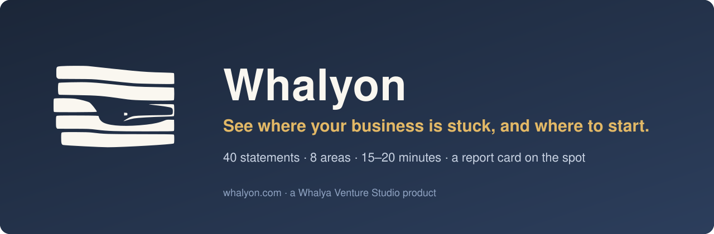
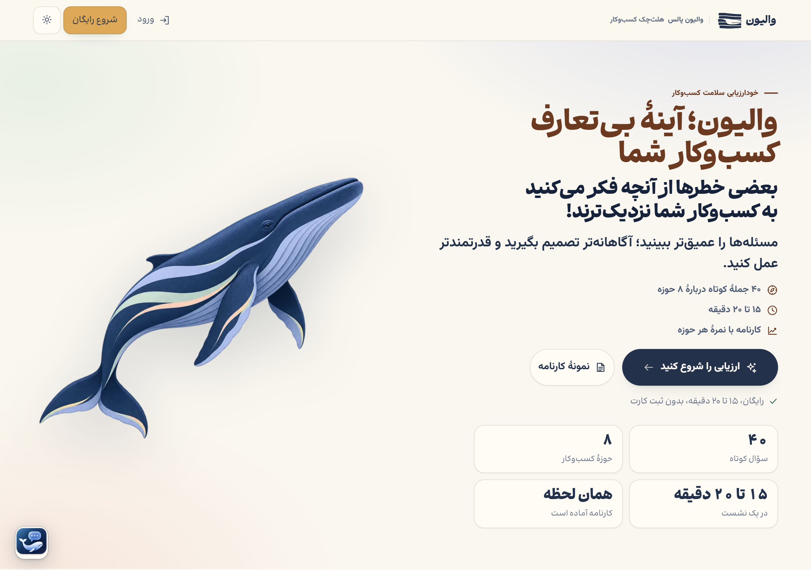
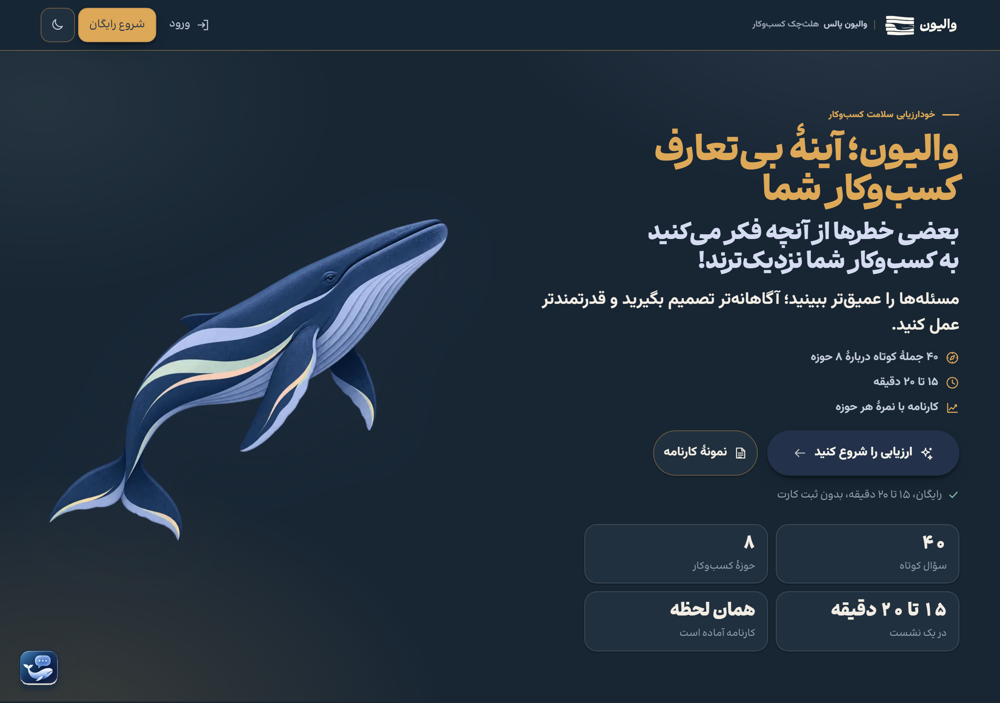
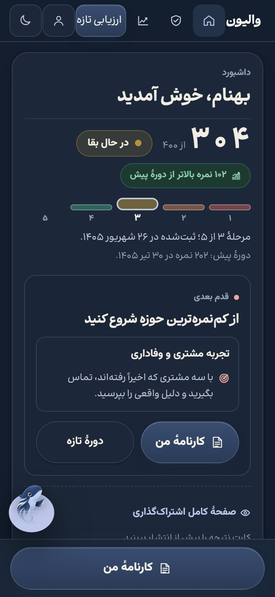
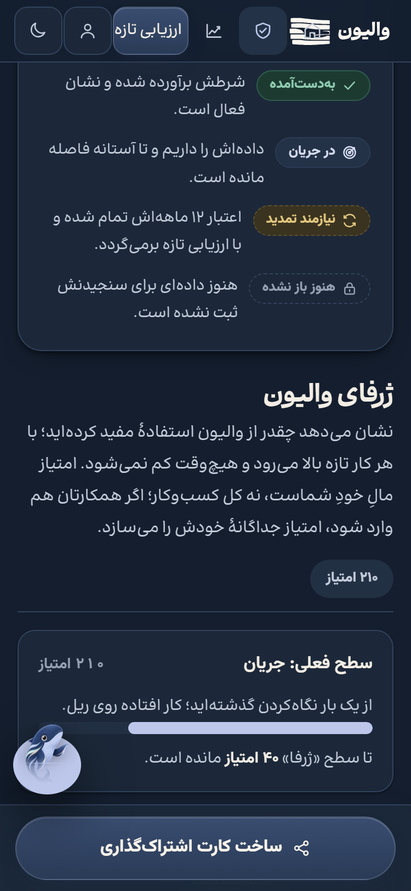

<p align="center"></p>

<p align="center">    </p>

<p align="center"><a href="https://whalyon.com">Website</a> · <a href="#try-it">Try it</a> · <a href="#screenshots">Screenshots</a> · <a href="CHANGELOG.md">Changelog</a> · <a href="SECURITY.md">Security</a></p>

> [!NOTE]
> **This is Whalyon's public page, not its source code.** The product is closed source and runs at [whalyon.com](https://whalyon.com). This repository holds the description, screenshots, changelog and the way to reach us.

# Whalyon

**A health check for your business. It finds the root cause, not the symptom.**

Sales are down, people are leaving, cash is tight. Those are symptoms.
Whalyon asks 40 short questions about eight parts of your business and shows which part is really holding the rest back.
You get a report card on the spot: a score for each area, the stage your business is in, and one concrete first step for each area, starting where the score is lowest.

```text
answer 40 statements -> score 8 areas -> find the weakest -> one first step -> check again later -> compare
```

## The numbers

| | |
|---|---:|
| Short statements to answer | **40** |
| Areas of the business they cover | **8** |
| Time it takes, in one sitting | **15–20 min** |
| Total score | **out of 400** |
| Growth stages a business can land in | **5** |
| Time until the report card is ready | **the same moment** |

## Who it is for

- **Owners and managing directors of small and mid-sized businesses** who feel something is wrong and want to know where to look first.
- **Founders** whose company still runs through them, and who want to see how much.
- **Consultants and advisers** who want a shared, plain-language starting point before the first meeting.

Today Whalyon speaks Persian and is built for businesses in Iran.

## Try it

1. Open **[whalyon.com](https://whalyon.com)** and press «شروع رایگان» (start free).
2. Answer the 40 statements. There are no right answers; the score only helps if it is honest.
3. Read your report card. Start with the first step under your lowest area.
4. Come back in a few months, take it again and compare the two report cards.

Starting is free and needs no card. Your answers stay with you.

## What it does

| You need | What Whalyon gives you |
|---|---|
| To know where you stand | A score for each of the 8 areas and a total out of 400 |
| To know what kind of trouble you are in | The stage of your business, from surviving to thriving |
| To know where to start | One concrete first step per area: what to do, who owns it, and how you will know it worked |
| A second opinion on your answers | An AI reading of your report card that connects the areas to each other |
| To see whether things got better | Two report cards side by side, with small changes marked as noise rather than progress |
| To show your team or partners | A share card for LinkedIn and Instagram, and a public badge page |

## The eight areas

| # | Area |
|---:|---|
| 1 | Vision, strategy and direction |
| 2 | Leadership, people and culture |
| 3 | Financial health and governance |
| 4 | Sales and business development |
| 5 | Marketing and market position |
| 6 | Operations, systems and processes |
| 7 | Customer experience and loyalty |
| 8 | Technology, risk and readiness to grow |

## Screenshots

<p align="center"></p>

<p align="center"></p>

<p align="center">

&nbsp;

</p>

## How it treats your data

- Answers belong to the person who gave them; nothing is published unless you make a share card yourself.
- Questions about feelings and satisfaction are left out on purpose, because they say more about the day than about the business.
- Small differences between two report cards are called noise, not progress, so you do not chase a number.

## Who makes it

Whalyon is made by **[Behnam Jafari Balalami](https://behnaam.com)**, founder of Whalya Venture Studio.
Whalya's products are [Whalyom](https://whalyom.com) (an AI marketing department inside Claude Code), [Whalory](https://whalory.com) (AI copywriting in Persian and English) and Whalyon.

| | |
|---|---|
| Email | [bjafaribox@gmail.com](mailto:bjafaribox@gmail.com) |
| Telegram | [@gilebehnam](https://t.me/gilebehnam) |
| LinkedIn | [behnamjafari](https://www.linkedin.com/in/behnamjafari) |
| A 30-minute call | [Book on Calendly](https://calendly.com/bjafaribox/30min) |
| The product | [whalyon.com](https://whalyon.com) |

## Feedback

Found something wrong on whalyon.com, or want Whalyon for your team? Open an issue here or write to the email above.
For security problems, please follow [SECURITY.md](SECURITY.md) instead of opening a public issue.

## License

The text, screenshots and brand marks in this repository are © Whalya Venture Studio, all rights reserved; see [LICENSE](LICENSE). Whalyon itself is closed source.
